tags: Linux Debian 装机 教程

[TOC]

## 太长不看

旧小主机用 Ventoy 装完 Debian 13，重启报 `No boot device has been detected`。最后的修法是：用 Ventoy 以 **Legacy（BIOS）方式**启动 Live 系统，然后执行：

```bash
# sda 是内置硬盘，先用 lsblk 确认！
sudo mount /dev/sda1 /mnt
sudo mount --rbind /dev  /mnt/dev
sudo mount --rbind /proc /mnt/proc
sudo mount --rbind /sys  /mnt/sys
sudo mount --rbind /run  /mnt/run
sudo chroot /mnt
grub-install --target=i386-pc /dev/sda   # 把 GRUB 写进硬盘的 MBR
update-grub
exit
sudo sfdisk --activate /dev/sda 1        # 给分区打上“活动”标记，老 BIOS 必须
sudo reboot
```

下面是完整的排查过程。

## 机器和环境

手上这台是二手的 **凌极云盒 LB-5**，原本是学校机房里做英语听说考试的云终端，闲鱼上一两百块就能买到。卖家只会装 Windows，我想装 Linux 用来学习。

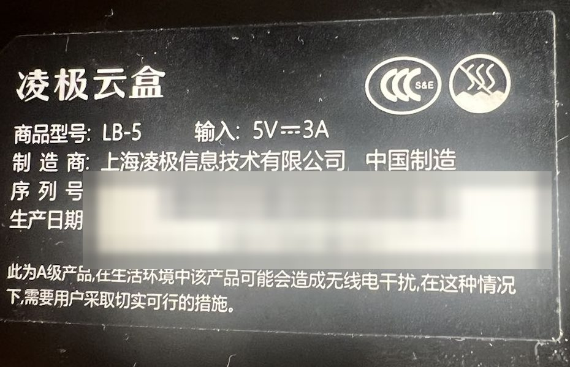

配置大概是这样的（CPU 和内存来自网上资料，硬盘型号是 `lsblk` 实际看到的）：

| 项目 | 配置 |
|---|---|
| CPU | Intel J3160 / N3160，4 核 4 线程，14nm，**支持 64 位** |
| 内存 | 4GB |
| 硬盘 | 32GB SATA 固态（型号显示为 `Kston 32GB`） |
| 网卡 | Realtek 千兆 |
| 电源 | 5V 3A，**建议只用原配电源** |

装机用的东西：

- U 盘：64GB，用 **Ventoy 1.1.18** 制作
- 镜像：`debian-live-13.7.0-amd64-xfce.iso`，直接拷到 Ventoy 盘根目录
- 4GB 内存加 32GB 硬盘，所以选了轻量的 **Debian 13 + Xfce**

安装过程很顺利，一路下一步就装完了。问题出在**重启之后**。

## 问题现象

拔掉 U 盘重启，屏幕左上角只有一行：

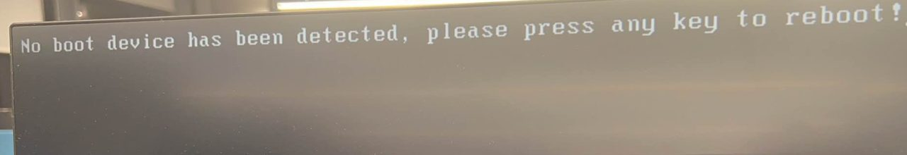

```text
No boot device has been detected, please press any key to reboot!
```

## 排查过程

### 1. 看启动菜单

开机连按 `Del`，这台机器弹出的是启动设备选择菜单：

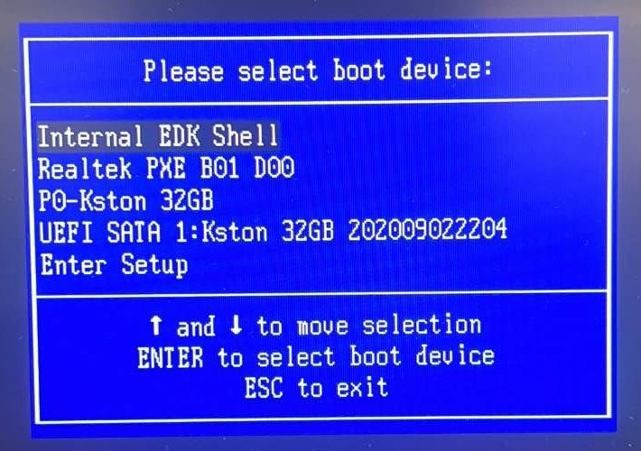

各项的含义：

| 选项 | 含义 |
|---|---|
| `Internal EDK Shell` | 主板自带的 UEFI 命令行，后面排查要用 |
| `Realtek PXE B01 D00` | 网络启动 |
| `P0-Kston 32GB` | 内置硬盘，**Legacy（BIOS）方式**启动 |
| `UEFI SATA 1:Kston 32GB ...` | 内置硬盘，**UEFI 方式**启动，只会去找默认路径 `\EFI\BOOT\BOOTX64.EFI` |
| `Enter Setup` | 进 BIOS 设置 |

注意列表里**没有 `debian` 这一项**。如果系统是按 UEFI 方式装好的，正常情况下这里会出现一个 `debian` 启动项。

分别试了两个硬盘入口：

- 选 `UEFI SATA 1:Kston 32GB`：屏幕闪一下，又回到这个菜单。
- 选 `P0-Kston 32GB`：报同样的 `No boot device has been detected`。

两条路都走不通。

### 2. 用 EDK Shell 看硬盘分区

选 `Internal EDK Shell`，它启动时会打印设备映射表：

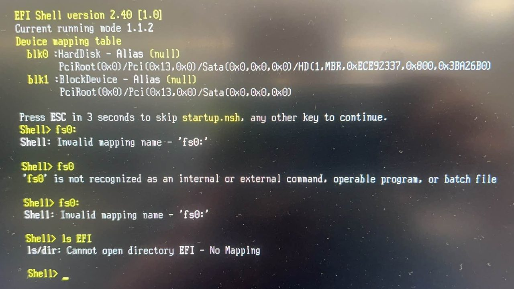

关键是这一行：

```text
blk0 :HardDisk - Alias (null)
      PciRoot(0x0)/Pci(0x13,0x0)/Sata(0x0,0x0,0x0)/HD(1,MBR,0xECE92337,0x800,0x3BA26B0)
```

从中能读出三件事：

- `HD(1,MBR,...)`：硬盘用的是 **MBR 分区表**，不是 GPT。
- 整个映射表里**只有一个分区**：起点 `0x800` 即 2048 扇区，长度 `0x3BA26B0` 约 29.8GB，也就是整块盘。
- **没有 `fs0:`**：EDK Shell 只能识别 FAT 格式的 EFI 系统分区（ESP），没有 `fs0:` 就说明根本没有 ESP。

结论：**系统是以 Legacy（BIOS）方式安装的**，不是 UEFI。原因很简单，Ventoy 当时就是用 BIOS 方式启动的。Ventoy 菜单底部会写明当前的启动方式：

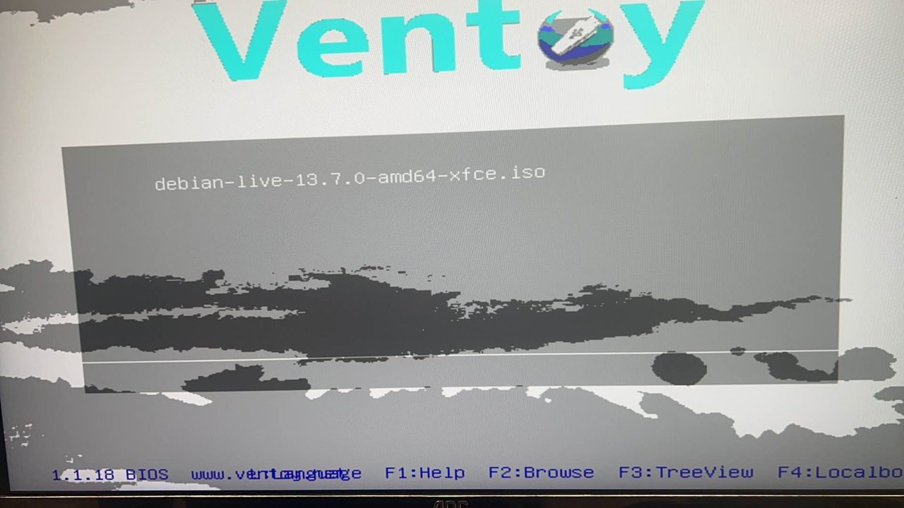

> 💡 **经验**：Ventoy 菜单左下角的 `1.1.18 BIOS` 或 `1.1.18 UEFI` 就是这次安装会采用的方式。装完系统后，开机也必须用同样的方式。

既然是 Legacy 方式安装，`UEFI SATA` 入口失败是正常的。真正要解决的是：**为什么 `P0-Kston` 这个 Legacy 入口也启动不了？**

## 修复步骤

### 1. 用 Legacy 方式启动 Live 系统

插上 U 盘，启动菜单里 U 盘出现了两个入口：

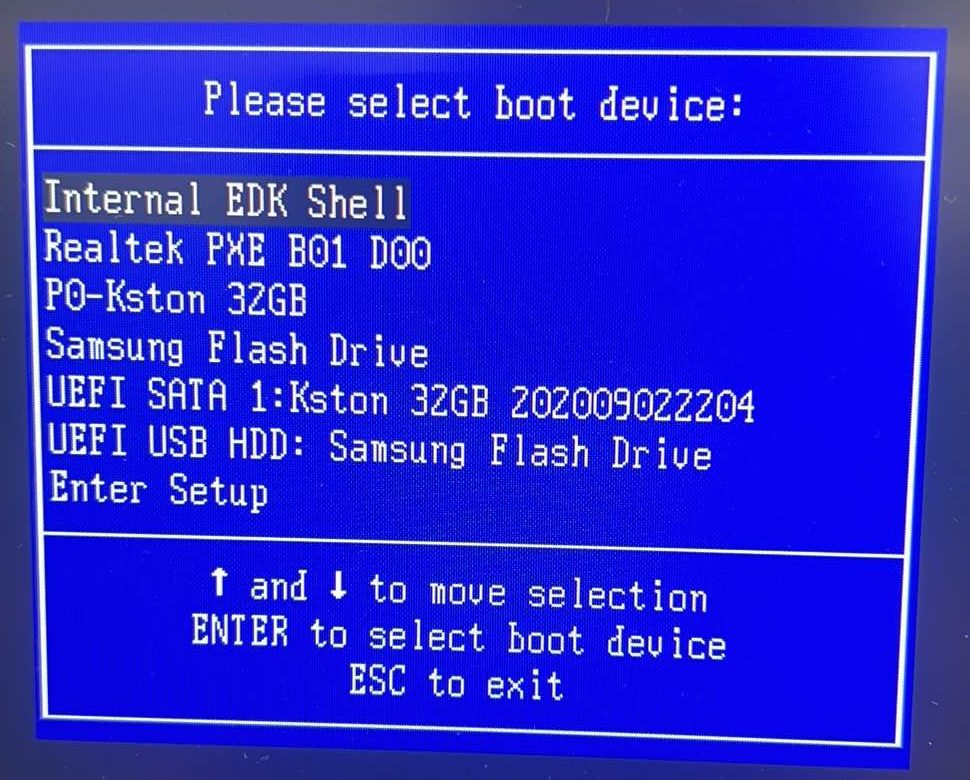

选 **不带 `UEFI` 字样** 的 `Samsung Flash Drive`，让 U 盘也用 Legacy 方式启动，和硬盘上的系统保持一致。

在 Ventoy 菜单选 iso 后，再选 `Boot in normal mode`：

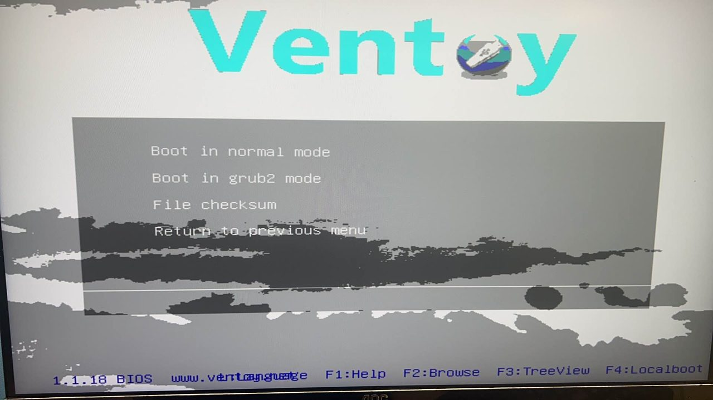

在 Debian 启动菜单里选 `Live system (amd64)`，**不要**选 `Start installer`：

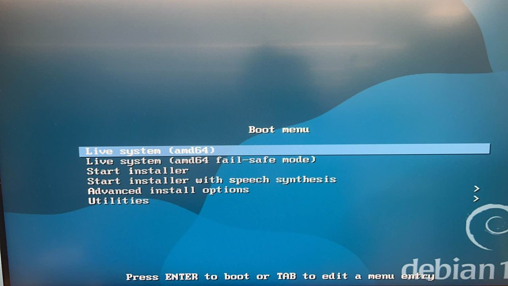

进入 Xfce 桌面后按 `Ctrl + Alt + T` 打开终端。Live 系统的默认用户名和密码是 `user` / `live`。

### 2. 确认哪块是内置硬盘

```bash
lsblk -o NAME,SIZE,FSTYPE,MODEL
```

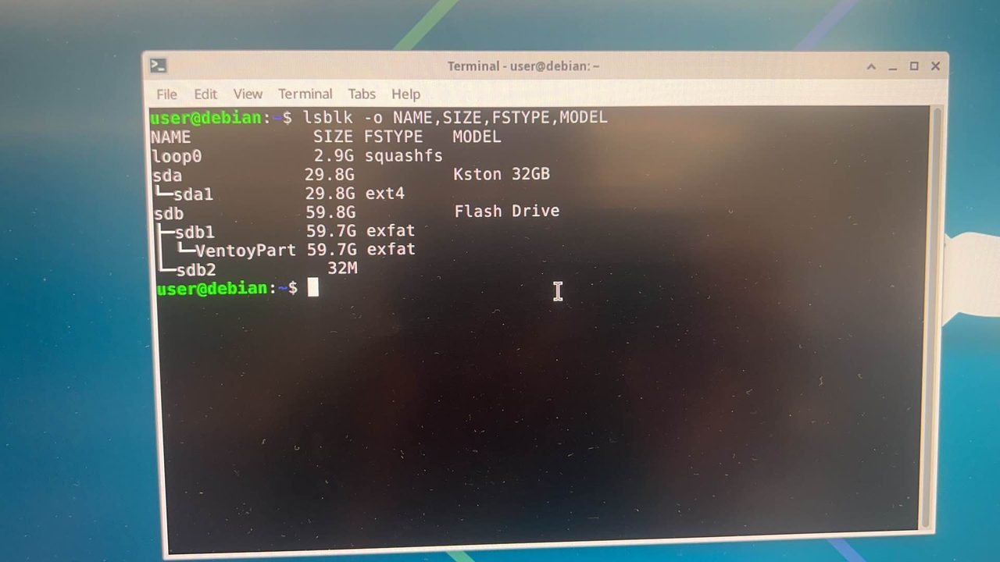

- `sda`：29.8G，`Kston 32GB`，带一个 `ext4` 分区 `sda1`，这是**装好的 Debian**。
- `sdb`：59.8G，`Flash Drive`，带 `VentoyPart` 分区，这是 **Ventoy U 盘**，后面**不要碰**。

> ⚠️ 不同机器上盘符可能相反，一定要按大小和型号确认，别照抄 `sda`。

### 3. chroot 进硬盘系统，补装 GRUB

```bash
sudo mount /dev/sda1 /mnt
sudo mount --rbind /dev  /mnt/dev
sudo mount --rbind /proc /mnt/proc
sudo mount --rbind /sys  /mnt/sys
sudo mount --rbind /run  /mnt/run
sudo chroot /mnt
```

提示符变成 `root@debian:/#` 后，说明已经切进硬盘上的系统了。接着把 GRUB 写进整块盘的 MBR。注意是 `/dev/sda`，**不是** `/dev/sda1`：

```bash
grub-install --target=i386-pc /dev/sda
```

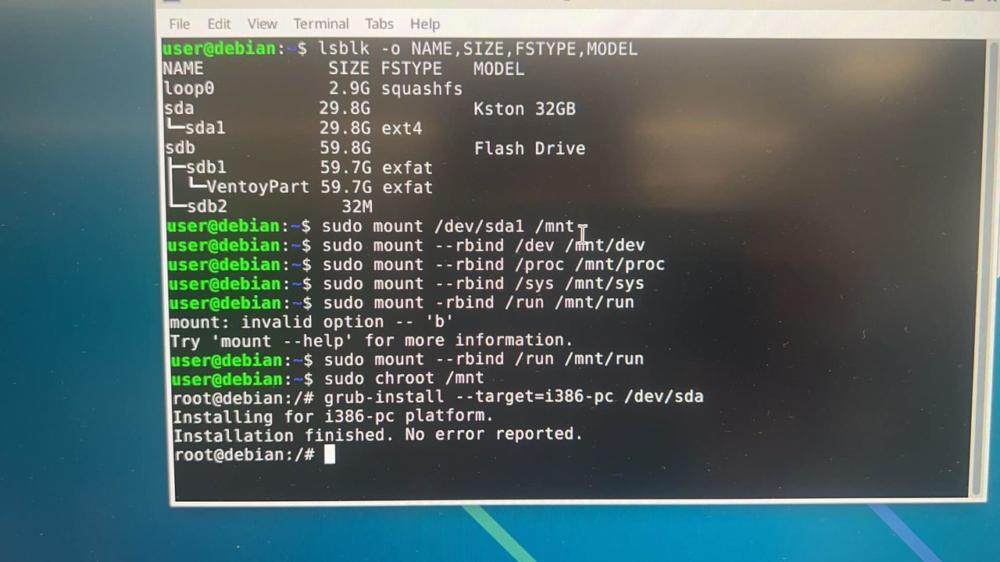

看到 `Installation finished. No error reported.` 就说明成功了。再生成启动菜单：

```bash
update-grub
```

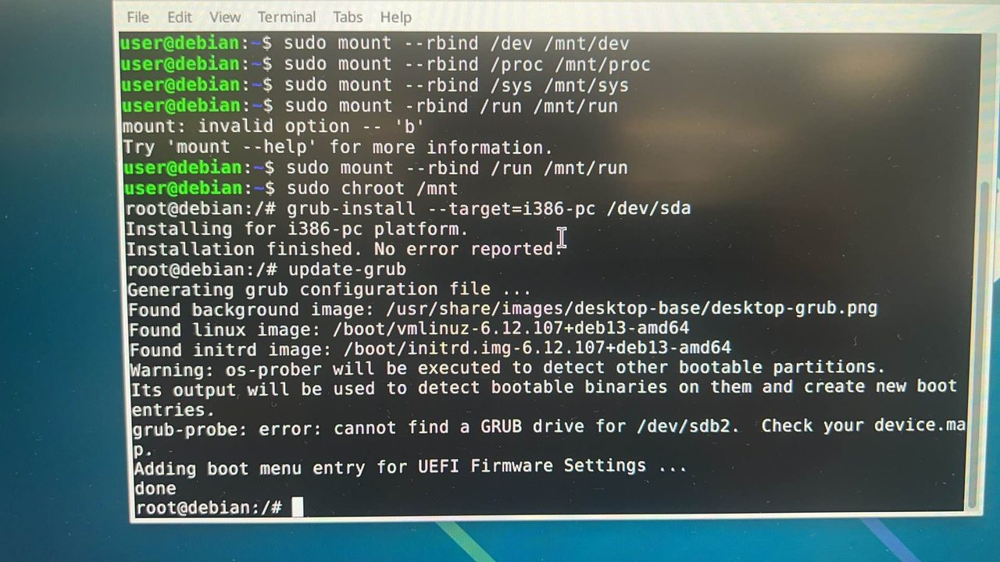

能看到 `Found linux image: /boot/vmlinuz-6.12.107+deb13-amd64` 就对了。中间那条 `grub-probe: error: cannot find a GRUB drive for /dev/sdb2` 是 os-prober 在扫描 Ventoy U 盘上的小分区，**可以忽略**。

> 如果提示 `grub-install: command not found`，说明系统里压根没装 grub-pc。这时插上网线，在 chroot 里执行 `apt update && apt install grub-pc`，弹窗里只勾选 `/dev/sda`。

然后 `exit` 退出 chroot，重启并拔掉 U 盘。

### 4. 还是 No boot device？给分区打“活动”标记

重启后**依旧**报 `No boot device has been detected`，手动选 `P0-Kston 32GB` 也一样。

到这一步 GRUB 已经确定写进 MBR 了，问题出在主板上：**很多老 BIOS 在 Legacy 模式下，要求 MBR 里有一个分区被标记为“活动分区”（active / boot flag）**，否则直接判定这块盘不可启动，连 MBR 里的代码都不会执行。

- Windows 安装程序会自动设置这个标记，所以卖家装 Windows 从来没遇到过这个问题。
- Linux 安装程序一般不设置，因为 GRUB 本身不需要这个标记。
- Ventoy U 盘能正常启动，正是因为 Ventoy 给自己的分区打了这个标记。

再次进入 Live 系统，在终端里执行：

```bash
sudo fdisk -l /dev/sda             # Boot 列是空的
sudo sfdisk --activate /dev/sda 1  # 给第 1 个分区打上 bootable 标记
sudo fdisk -l /dev/sda             # Boot 列出现 *
```

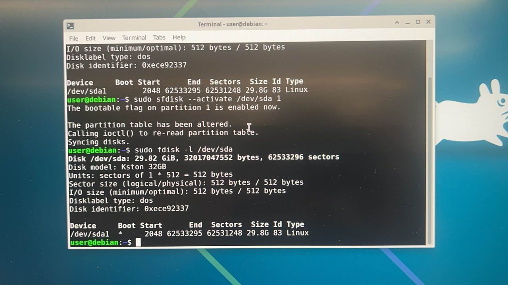

看到 `The bootable flag on partition 1 is enabled now.`，并且 `/dev/sda1` 的 `Boot` 列出现 `*`，就说明标记打上了。这个操作只改分区表里的一个标志位，不会碰数据，也不会覆盖刚才写进 MBR 的 GRUB。

如果系统里没有 `sfdisk`，用 `sudo parted /dev/sda set 1 boot on` 效果一样。

### 5. 重启，成功

```bash
sudo reboot
```

屏幕一黑就拔掉 U 盘。这次先出现 GRUB 菜单，然后正常进入 Debian 登录界面。🎉

> 注意：U 盘插着的时候，主板会优先从 U 盘启动，进的还是 Ventoy。这不代表没修好，拔掉 U 盘再试。

## 问题根因小结

| 环节 | 情况 |
|---|---|
| 安装方式 | Ventoy 以 BIOS 方式启动，所以 Debian 被装成 MBR 分区表加 Legacy GRUB，没有 EFI 分区 |
| GRUB | 修复前 Legacy 入口启动失败；Ventoy 菜单完好，说明 GRUB 没被写到 U 盘上。安装时 GRUB 到底有没有写进 `sda` 无法确定，稳妥起见重新执行了 `grub-install` |
| 活动分区 | 这台主板的 Legacy 启动**强制要求**活动分区标记，安装程序没设置。**这是最终起作用的修复** |

## 装好之后建议做的事

**1. 固定 GRUB 的安装位置。** 这样以后系统更新 GRUB 时会自动重写 MBR，避免 MBR 里的旧代码和 `/boot/grub` 里的新模块版本对不上，导致开不了机：

```bash
sudo dpkg-reconfigure grub-pc
```

前面几页直接回车。到 `GRUB install devices` 那一页时，用空格**只勾选 `/dev/sda`**，然后回车。

**2. 更新系统：**

```bash
sudo apt update && sudo apt full-upgrade
```

**3. 如果偶尔整机卡死。** J3160 / N3160 这一代 Atom 架构的 CPU 有个 C-state 相关的老毛病。可以编辑 `/etc/default/grub`，在 `GRUB_CMDLINE_LINUX_DEFAULT="quiet"` 的引号里加上 `intel_idle.max_cstate=1`，然后执行 `sudo update-grub`。不卡就不用加。

## 经验

1. **Ventoy 左下角的 `BIOS` / `UEFI` 决定了系统会被装成哪种启动方式**，装之前先看一眼。
2. **主板自带的 EDK Shell 是很好的诊断工具**：映射表里能直接看出分区表类型（MBR / GPT）和有没有 EFI 分区。
3. **老主板 Legacy 启动报 `No boot device`，先检查活动分区标记**（`fdisk -l` 的 `Boot` 列），一条 `sfdisk --activate` 就能解决。
4. **Ventoy U 盘别格式化**，留着当救援盘。系统坏了可以像这次一样进 Live 系统，chroot 进去修。
